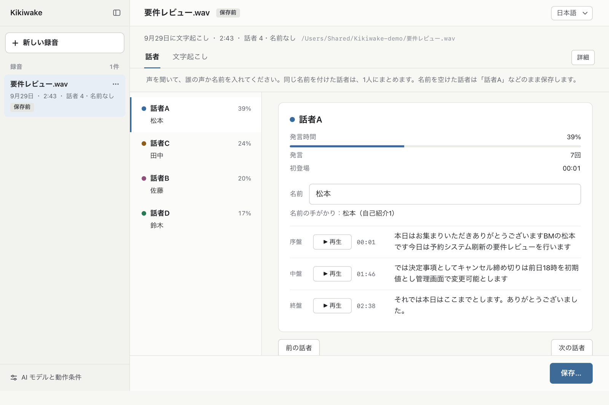
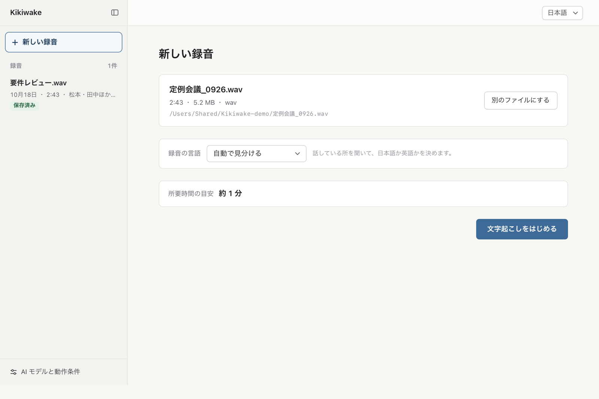
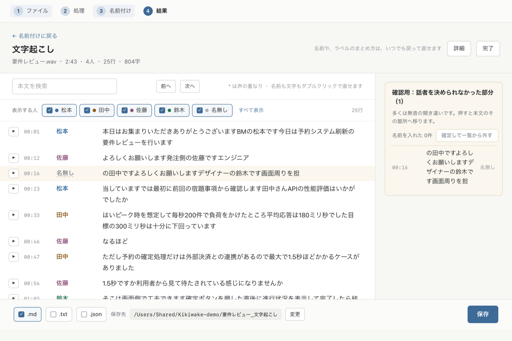

# Kikiwake（聞き分け）

> **English:** Kikiwake is a macOS app that turns meeting recordings into speaker-labeled transcripts, entirely on your Mac.
> The app is available in **Japanese and English**. Transcription currently supports **Japanese recordings only**.

会議の録音・録画から、「誰が・何を話したか」が分かる文字起こしを作る Mac のアプリです。
**音声も文字も、この Mac の中だけで処理します。**

## できること

- 録音・録画（.m4a・.mp3・.wav・.mp4・.mov）をドラッグするだけで、話者ごとに分けて文字起こしする
- 話者ごとに声を聞いて名前を付ける。自己紹介など、名前の手がかりも出す
- 結果の画面で、行ごとの名前や文字を直してから保存する（.md・.txt・.json）
- 4 時間ほどの長い録音でも、メモリを使いすぎずに最後まで処理する
- 画面は日本語と英語（Mac の言語に合わせて始まり、窓の右上で切り替えられる。保存するファイルの見出しなども画面の言語で）。書き起こせるのは、今は日本語の録音だけ

| ファイルを選ぶ | 結果 |
|---|---|
|  |  |

## 必要なもの

- Apple シリコン（M1 以降）の Mac と、macOS 14 以降
- メモリ 16GB 以上をおすすめ（8GB の Mac では注意が出ます。長い録音は、ほかのアプリを閉じてから処理してください）
- 空き容量 4GB 以上（AI モデル約 3.2GB と作業用）
- 初回だけインターネット（AI モデルを取得するため）

いまのところ、確かめたのは MacBook Air（M4・16GB）と macOS 26 の組み合わせだけです。

## 入れ方

1. [Releases](https://github.com/enomoso-pm/kikiwake/releases) から `Kikiwake_<版>_aarch64.dmg` を落とします
2. 開いて、「Kikiwake」を「アプリケーション」にドラッグします
3. 初めて開くときだけ、macOS の確かめが要ります。Kikiwake は Apple の有料の開発者登録をしていないので、そのままでは「開けません」と出ます
   - **macOS 15 以降**:
     1. 「Kikiwake」を開きます。開けないという警告が出たら「完了」を押します（「ゴミ箱に入れる」は押さないでください）
     2. アップルメニュー →「システム設定」→「プライバシーとセキュリティ」を開きます
     3. 下のほうの「セキュリティ」にある、Kikiwake がブロックされたという表示の横の「このまま開く」を押し、パスワードを入れます
     4. もう一度出る確かめで「このまま開く」を押すと開きます
   - **macOS 14**: Finder で「Kikiwake」を右クリック →「開く」→ もう一度「開く」
   - 2 回目からは普通に開けます

落としたファイルが本物かは、Releases に載せた照合用の値（SHA-256）と `shasum -a 256 Kikiwake_<版>_aarch64.dmg` の結果が同じかで確かめられます。

## 使い方

1. **準備**（初回だけ）: 動作条件を確かめて、AI モデル（約 3.2GB）を取得します
2. **ファイル**: 録音・録画を窓にドラッグします（または「ファイルを選ぶ」）
3. **処理**: 待ちます。M4 の Mac で録音の長さの 0.2〜0.4 倍ほど（68 分の録音で約 15 分）。処理中はスリープしません
4. **名前付け**: 話者ごとに「▶ 再生」で声を聞き、名前を入れます
5. **結果**: 確かめて、必要なら直して、保存します。保存先は、元のファイルの隣の「〈元の名前〉_文字起こし」フォルダです（英語の画面では「〈元の名前〉_transcript」）

**履歴**: ファイルの画面の「履歴」から、前に文字起こしした録音を開き直せます。閉じたときの画面（名前付け・結果）に、入れかけの名前や直した文字のまま戻ります（保存していなくても残ります）。処理の途中で閉じた録音は「続きから」処理でき、要らなくなった録音は履歴から消せます（元の録音と、保存した文字起こしのファイルは消えません）。

## 音声と文字の扱い

- 処理はすべてこの Mac の中で行います。音声も文字も外に送りません。使い方の送信（テレメトリ）もありません
- インターネットを使うのは、初回の AI モデルの取得だけです（取得先は huggingface.co）
- 作業用のファイル（履歴）は `~/Library/Application Support/Kikiwake/jobs/` に置きます（1 時間の録音で約 8MB）。使い終えた録音から取り出した音声は、別の録音を始めたときとアプリを終えるときに消します。書き起こし・名前・手直しは、履歴から消すまで残ります。元の録音・録画と、保存したファイルには触りません
- ログ（`~/Library/Logs/Kikiwake/kikiwake.log`）には、処理の段階・時刻・エラーだけを書きます。文字起こしの中身と、録音の名前・場所は書きません
- 会議などを録音するときは、話す人の了承を得てください

## 消し方

アプリを「アプリケーション」からゴミ箱に入れたうえで、次のフォルダを消します。

| フォルダ | 中身 |
|---|---|
| `~/Library/Application Support/Kikiwake` | AI モデル（約 3.2GB）と履歴（作業用のファイル） |
| `~/Library/Caches/Kikiwake` | 画面の一時ファイル（前の版の作業用のファイルは、新しい版を開くと上へ移す） |
| `~/Library/Logs/Kikiwake` | ログ |

## 困ったとき

- エラーの帯の「詳細をコピー」の中身と、ログの最後のほうを添えて、[Issue](https://github.com/enomoso-pm/kikiwake/issues) で知らせてください（どちらにも文字起こしの中身は入りません。ファイルの場所はホームフォルダを「~」にして出します）
- 会社のネットワークなどで AI モデルを取得できないときは、別の回線で次の 2 つを落とし、`~/Library/Application Support/Kikiwake/models/` に同じ名前で置いてください

| ファイル | 大きさ | SHA-256 | 取得先 |
|---|---|---|---|
| `ggml-large-v3.bin` | 3,095,033,483 バイト | `64d182b440b98d5203c4f9bd541544d84c605196c4f7b845dfa11fb23594d1e2` | [huggingface.co/ggerganov/whisper.cpp](https://huggingface.co/ggerganov/whisper.cpp/resolve/5359861c739e955e79d9a303bcbc70fb988958b1/ggml-large-v3.bin) |
| `Nemotron-3-Diarization.q8_0.gguf` | 107,012,128 バイト | `08456d9e22cd9a323c0364d98375f3746d6e68507ebb705cd46438c534c7a3a1` | [huggingface.co/nvidia/Nemotron-3-Diarization](https://huggingface.co/nvidia/Nemotron-3-Diarization/resolve/f667ed73aee57d40cc39428eb768b4fd87a0a29e/Nemotron-3-Diarization.q8_0.gguf) |

## しくみ

| 部分 | 使っているもの |
|---|---|
| 音声の取り出し | macOS の AVFoundation（自作の `decode-avf`） |
| 話者の判定 | [NeMo-Speech.cpp](https://github.com/NVIDIA/NeMo-Speech.cpp) と Nemotron 3 Diarization（自作の `kikiwake-diar` で少しずつ流し込む） |
| 書き起こし | [whisper.cpp](https://github.com/ggml-org/whisper.cpp) と Whisper large-v3（GPU は Metal） |
| 突き合わせ・名前の手がかり・保存 | Rust（`core/`） |
| 画面と外枠 | [Tauri 2](https://tauri.app/)・React・TypeScript |

架空の 4 人会議（約 2 分 40 秒）での精度: 話者の誤り率（DER）12.7%、文字の誤り率 2.8%、話者の正解率 94%。

## 作り方（開発する人向け）

ソースからの作り方・テスト・リポジトリの中身は [docs/BUILD.md](docs/BUILD.md) にあります。

## ライセンス

Kikiwake は [MIT ライセンス](LICENSE) です。使っているもののライセンスの一覧は [THIRD_PARTY_NOTICES.txt](THIRD_PARTY_NOTICES.txt) にあり、アプリのメニューの「ヘルプ」→「ライセンス（全文）」からも見られます。

AI モデルはアプリに含めず、初回にそれぞれの取得先から取得します: Whisper large-v3（OpenAI・MIT）、Nemotron 3 Diarization（NVIDIA・OpenMDW 1.1）。

---

## English

Kikiwake (聞き分け, "telling voices apart") is a macOS app that creates speaker-labeled transcripts from meeting recordings.
Everything runs locally on your Mac: no audio or text is sent anywhere, and there is no telemetry. The only network access is the one-time download of the AI models from Hugging Face.

- **Language:** The app is available in **Japanese and English**. It starts in your Mac's language, and you can switch at the top right of the window. Saved transcripts follow the app's language. Transcription currently supports **Japanese recordings only**.
- **Requirements:** Apple silicon Mac, macOS 14 or later, 16 GB of memory recommended, about 4 GB of free disk space.
- **History:** Reopen past recordings from “History” on the file screen. You return to where you left off, including names you were typing and text you edited (even if you didn't save a file). Unfinished recordings can continue processing. Deleting from History removes only Kikiwake's working data, not your recording or saved transcripts.
- **Install:** Download the `.dmg` from [Releases](https://github.com/enomoso-pm/kikiwake/releases) and drag Kikiwake to Applications. The app is not notarized by Apple, so on first launch go to System Settings → Privacy & Security and click "Open Anyway" (macOS 15 or later). Step-by-step instructions are in `Read Me First.txt` in the `.dmg`.
- **Built with:** whisper.cpp (Whisper large-v3), NeMo-Speech.cpp (Nemotron 3 Diarization), Tauri, React, and Rust.
- **License:** MIT. See [THIRD_PARTY_NOTICES.txt](THIRD_PARTY_NOTICES.txt) for third-party licenses.
